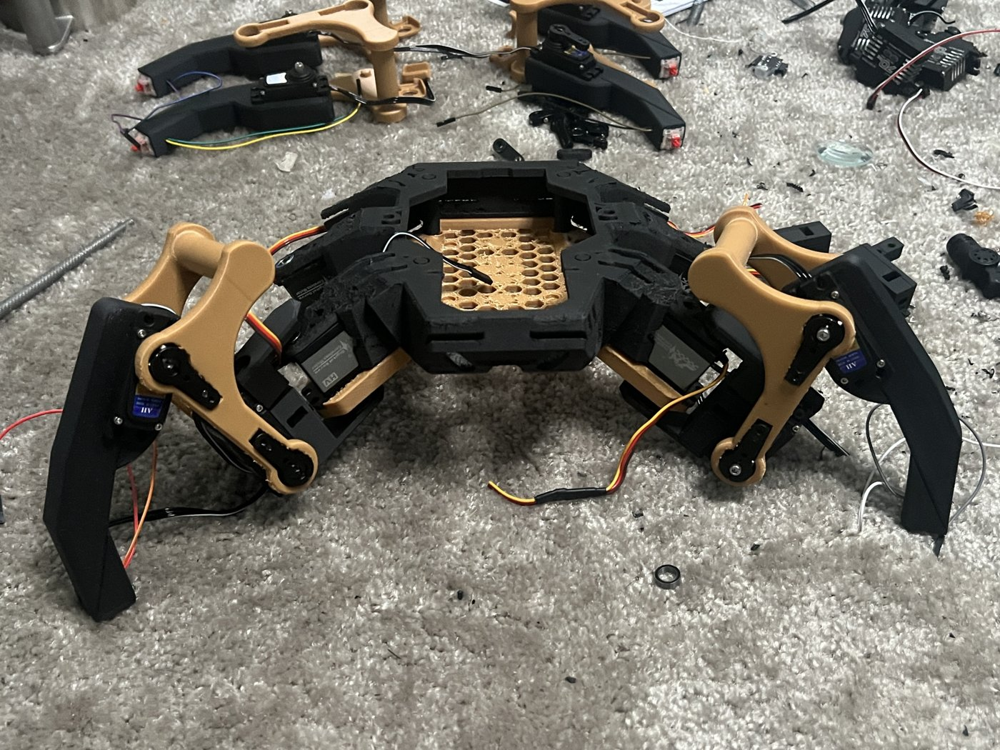
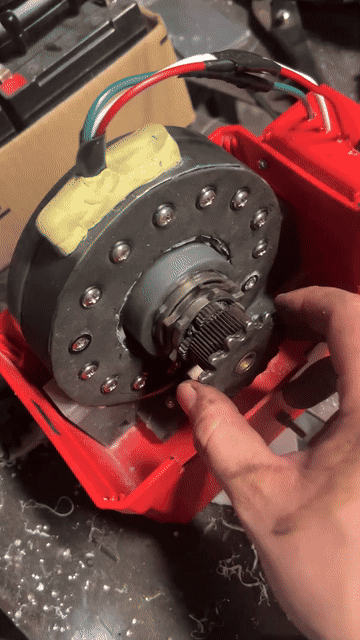
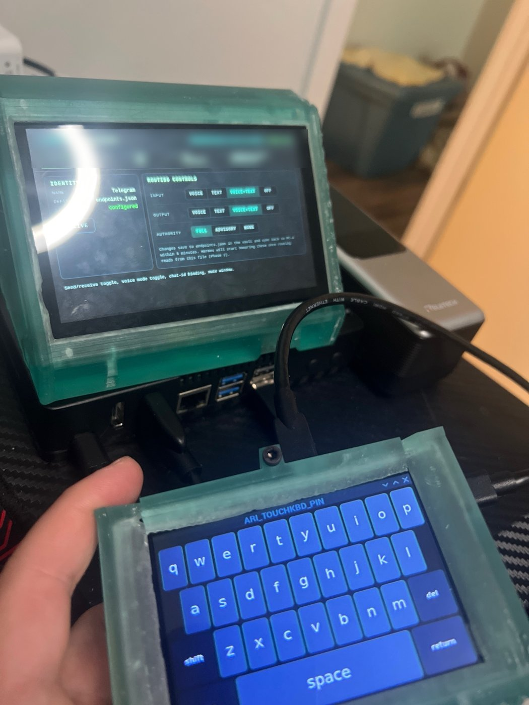
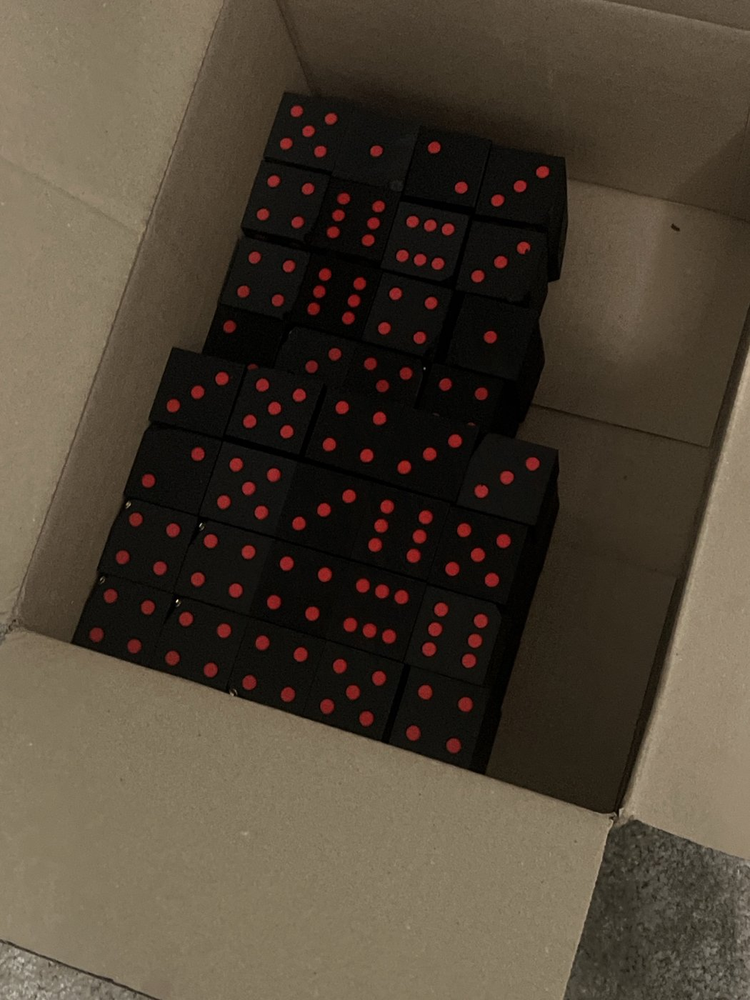

# Builds

Physical things I've designed and made. Photos only: no model files are published.

| | |
|---|---|
|  **Hexapod, first prototype** — hand-fabricated aluminum brackets, hobby servos, depth camera, power-tool batteries. Where the robot started. |  **Hexapod, current build** — printed frame and legs, mid-assembly. Femurs and tibias designed in Onshape. Software: [hexapod-rl](https://github.com/tardigraderesearch/hexapod-rl). |
|  **Axial-flux motor** — my stator and rotor design, hand-wound coils. [Clip](media/axial-flux-motor.mp4) |  **Desk deck** — Raspberry Pi control panel with printed enclosures and a touch interface for my assistant, [ARI](https://github.com/tardigraderesearch/ari). |
|  **Award dice** — a production batch of dice I designed and printed for a set of award plaques. | |

---
© 2026 tardigraderesearch. All rights reserved.
