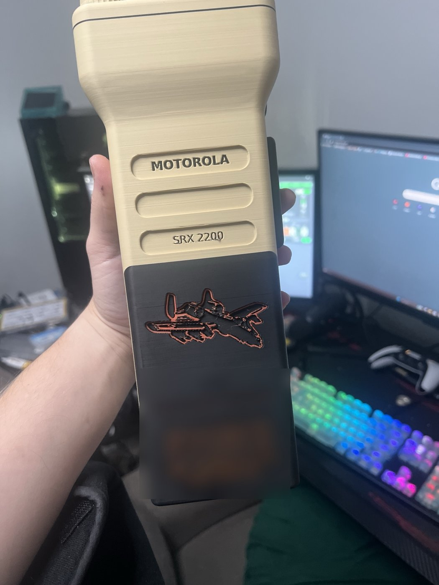
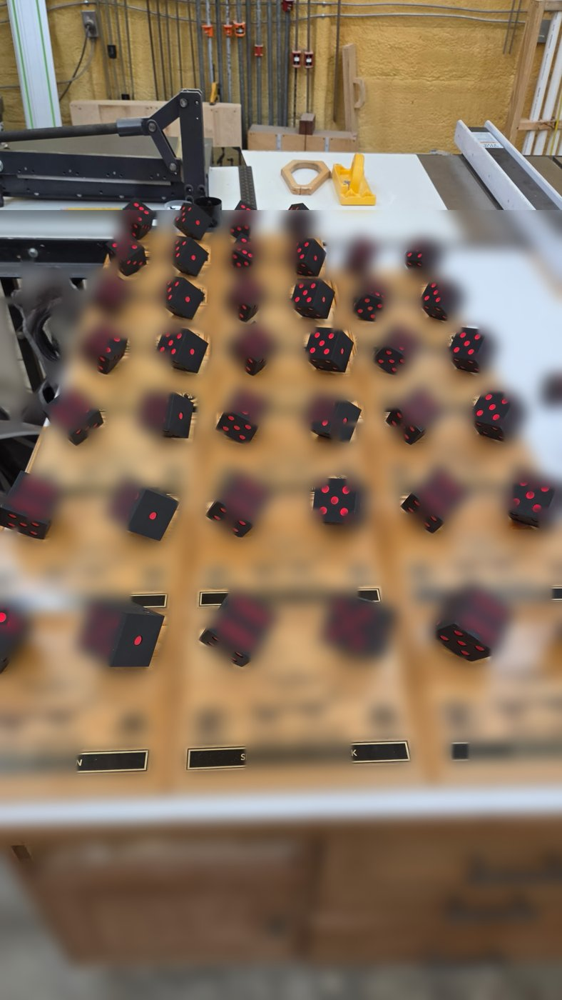
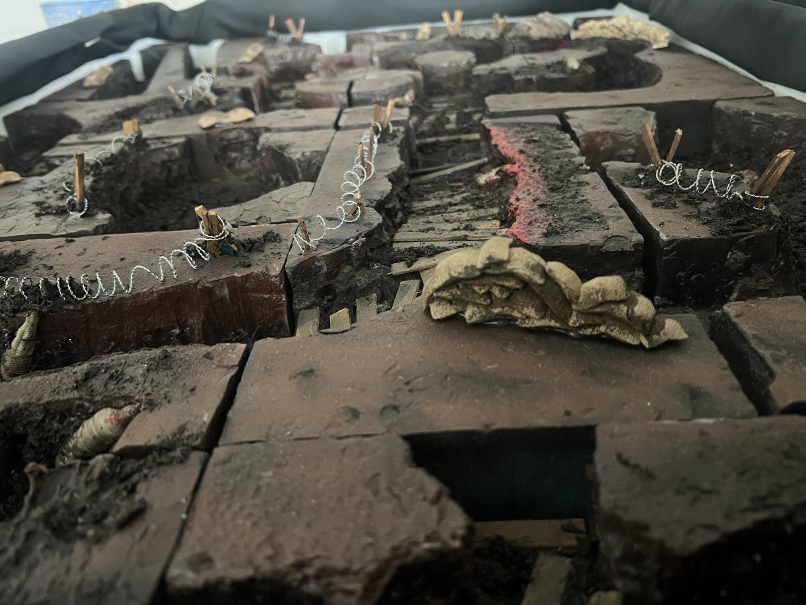
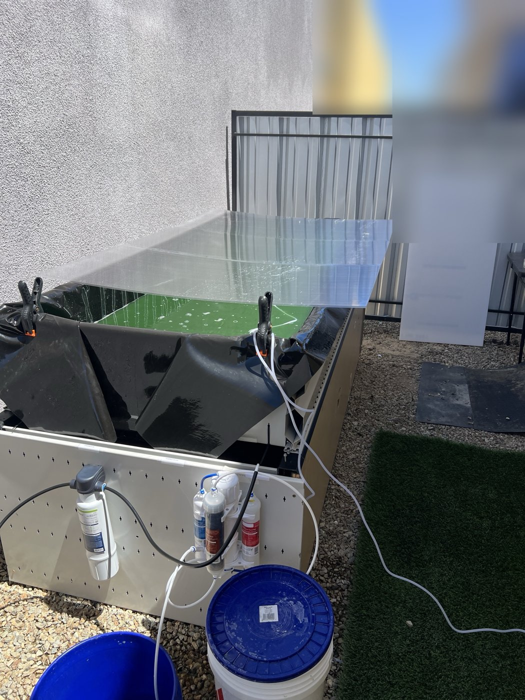

# Builds

Physical things I've designed and made, or made in collaboration.
Photos only: no model files are published.

| | |
|---|---|
|  **Hexapod (current build)** — printed frame and legs, mid-assembly. Femurs and tibias designed in Onshape. Software: [hexapod-rl](https://github.com/evilhobo1911/hexapod-rl). |  **Hexapod (first prototype)** — hand-fabricated aluminum brackets, hobby servos, depth camera, power-tool batteries. Where the robot started. |
|  **Axial-flux motor** — prototype motor build. [Clip](media/axial-flux-motor.mp4) |  **Desk deck** — Raspberry Pi control panel with printed enclosures and a touch interface for my assistant, [ARI](https://github.com/evilhobo1911/ari). |
|  **Award radio replica** — a modeled and printed replica radio, made as a personalized award (dedication blurred). |  **Award dice** — a production batch of printed dice for a set of award plaques. |
|  **Award plaques** — the finished set, made in collaboration (names blurred). |  **Tabletop trench terrain** — modular trench board for tabletop games. |
|  **Algae culture tank** — outdoor culture tank with a filtered water supply. | |

---
© 2026 evilhobo1911. All rights reserved.
